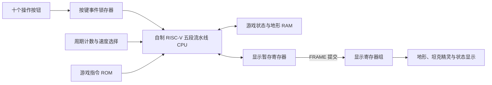

# 系统设计说明

## 结构

CPU 复用原工程的“◇重定向流水线”，新增 TankCore 副本接入外设。
旧 CPU 的监测输出改为探针，中断输入固定为 0。本版使用轮询，不依赖中断。
时钟、寄存器堆、ALU、流水线及控制器继续使用原电路。

## 存储布局（CPU 字节地址）

| 区域 | 内容 |
|---|---|
| 0x000..0x02f | 状态、得分、生命、逻辑步数、计时、敌军数量、结果、基地生命、最高分、重生保护、射击计数、全量绘制标记 |
| 0x040..0x04f | 玩家坦克记录 |
| 0x030..0x03f | 当前关卡、敌军总数、后备敌军数、AI 累计拍数 |
| 0x050..0x05f / 0x060..0x06f | 两辆敌军记录 |
| 0x080..0x0bf | 四个炮弹记录 |
| 0x0c0..0x0db | 上帧七个实体所在格的缓存 |
| 0x0e0..0x0ef | 本逻辑步四枚炮弹的预计落点 |
| 0x0f0..0x0ff | 四枚炮弹的待抵消标志 |
| 0x100..0x4ff | 256 格地形，每格一个 32 位字 |
| 0x500..0x6ff | 8 个列位置 × 16 种精灵的移位查找表 |
| 0x700..0x7ff | 控制和状态 I/O 页 |
| 0x800..0x8ff | 显示 I/O 页，已定义前 32 个字 |
| 0x900..0x92b | 强化等级、掉落位置、背包、两辆敌军装甲、击杀数、使用次数、子弹拍数、掉落累积数、两辆敌军绕行方向 |
| 栈顶 0xfc0 | 向下增长，不与数据表或 I/O 重叠 |

坦克与炮弹记录都使用四个字：位置、方向、活动标志、所属方。
位置编码为 y×16+x；方向 0/1/2/3 表示上/右/下/左。
所属方 0 为玩家，1/2 为两辆敌军。

## I/O

| 地址 | 读写 | 功能 |
|---|---|---|
| 0x700 | 读 | 锁存的十位按键事件 |
| 0x704 | 读 | CPU 时钟周期数 |
| 0x708 | 读 | 自动推进等待间隔，0 代表手动 |
| 0x70c | 写 | 写 1 清除对应已消费事件 |
| 0x710 | 读 | 请求关卡 0/1/2，仅在重开时采样；3 按困难处理 |
| 0x714 | 读 | 子弹间隔：0/2 为两拍，1 为一拍，3 为三拍 |
| 0x740 | 读写 | STATUS |
| 0x744 | 读写 | SCORE |
| 0x748 | 读写 | LIVES |
| 0x74c | 读写 | ALIVE |
| 0x750 | 读写 | CAUSE |
| 0x754 | 读写 | BASEHP |
| 0x758 | 读写 | TICK |
| 0x75c | 读写 | BEST |
| 0x760 | 读写 | FRAME，写入时同步提交整帧 |
| 0x764..0x780 | 读写 | UPGRADE、PICKUP、ITEMS、ARMOR1、ARMOR2、USES、POS1、POS2，均在 FRAME 时一起提交 |
| 0x800+4×i，i=0..31 | 读写 | 显示暂存字，每个字存八个四位精灵编号 |

按键位 0..9：UP、RIGHT、DOWN、LEFT、START、PAUSE、RESTART、FIRE、STEP、USE。
每个事件由 D 触发器锁存，短按可跨 CPU 轮询周期保存；一个按键仅保留一次待处理事件。
真实 FPGA 迁移还需要加入按键消抖和跨时钟域同步。

## 精灵与显示

| 编号 | 内容 |
|---|---|
| 0 | 空地 |
| 1 | 砖墙 |
| 2 | 钢墙 |
| 3 | 基地 |
| 4..7 | 玩家坦克，上/右/下/左 |
| 8..11 | 敌军坦克，上/右/下/左 |
| 12 / 13 | 玩家/敌军炮弹 |
| 14 | 两次命中的基地护墙；第一次命中后改为普通砖墙 1 |
| 15 | 坦克爆炸 / 基地损毁 |

第 i 格位于暂存字 i÷8 的第 (i mod 8)×4 位，低位对应较小横坐标。
显示外设只读取这 32 路数据和状态端口，把编号绘成图案；不改变任何游戏状态。

全量绘制只在重开时进行。其他更新先恢复旧实体格，再绘制新实体；砖墙和基地变化由 CPU 同步更新地形与暂存显示。
FRAME 最后写入，外围寄存器统一提交，避免显示中间状态。

## 调度与碰撞

方向和射击事件在读取后立即处理；炮弹及敌军按自动周期或 STEP 推进。
普通输入引起的绘图不会重置物理计时，避免连续移动把敌军逻辑一直推迟。

每个逻辑步累计子弹拍数，达到所选间隔才预测轨迹、统一处理抵消和推进炮弹；敌军的行动频率独立计时，按训练 / 进阶 / 困难每 4 / 3 / 2 步的频率补入后备敌军，再执行追击和射击。
ALIVE 包含活动和后备敌军，分别初始为 2 / 4 / 6，只有全部消灭才获胜。复用两个敌军槽，补入时检查玩家及另一敌军是否占据出生点。
预测过程只读取同一份步前位置，比较四枚炮弹的六种配对。落点相同或迎面互换位置时先记录双方标志，所有配对完成后再统一移除。
这样多弹碰撞不会因为先更新某枚炮弹、或提前移除某个配对而漏判。玩家一方与敌方之间才进行抵消；敌方 owner=1、2 视为同一阵营。
遇到地形的预计落点不参与抵消，保留原地形碰撞处理。正常空地的抵消先于坦克受伤判定，因此可以用炮弹拦截来保护坦克。
敌军优先缩短横向距离，同列时缩短纵向距离；受阻时记住原方向，向该方向射击以破坏砖墙，再尝试沿边绕行。后续行动优先重试原方向，能前进后退出绕行模式。
该 AI 是可解释的基础规则，没有寻路算法。

所有地形碰撞、生命变化、分数和胜负均由汇编程序实现。
本程序采用标准保存寄存器原则：子程序保存自己使用的 s 寄存器，s8/s9/s10 为主循环标志与事件，s11 为 I/O 基址。

强化、拾取、手动激活、敌军装甲和基地护墙耐久均由汇编计算；显示组件只读取 CPU 提交的装甲、坐标与道具元数据绘图。s7 固定为扩展状态基址 0x900。
