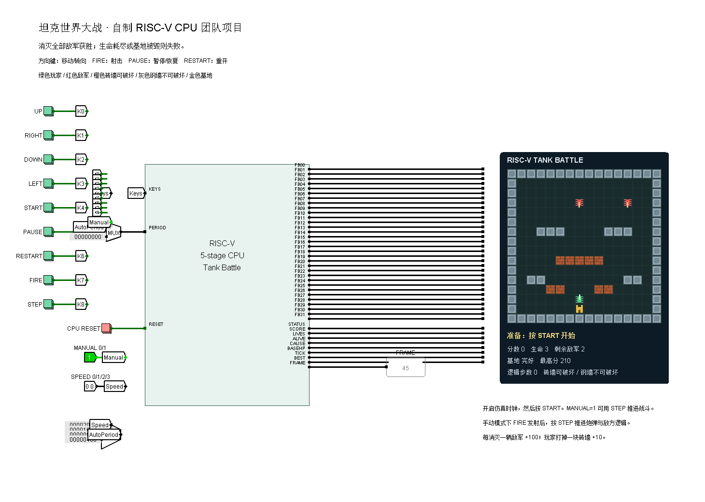
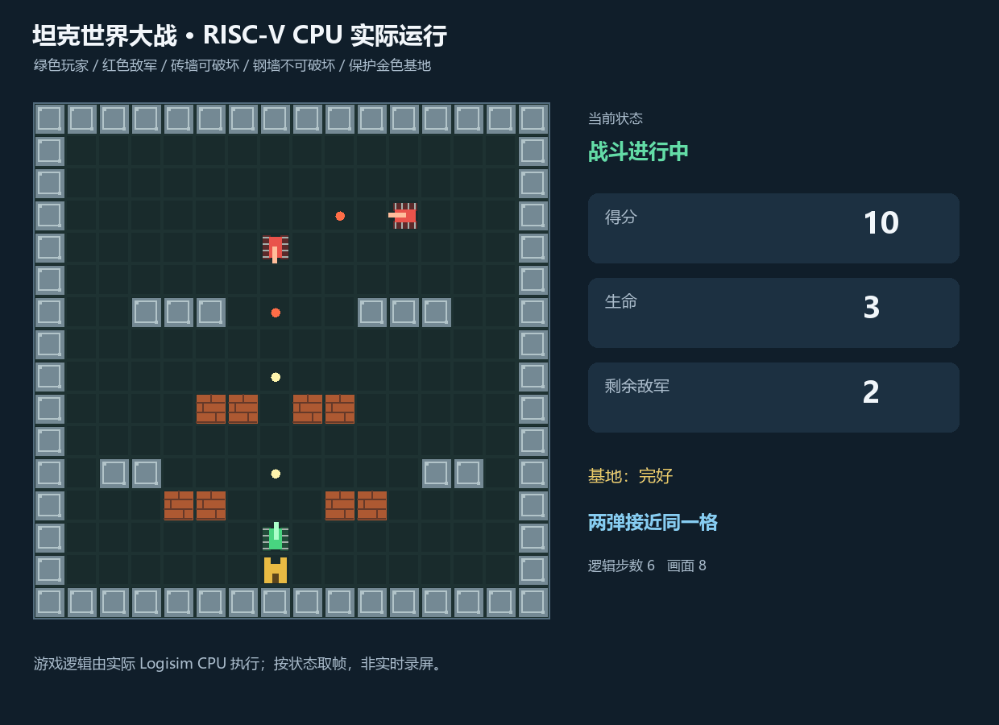
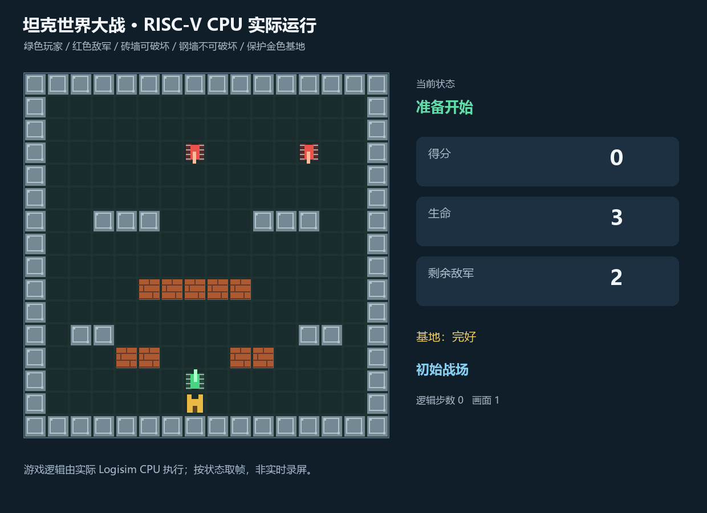

# 坦克世界大战：自制 RISC-V CPU 团队项目

这是在你们原有 Logisim“◇重定向流水线”CPU 上运行的俯视角 2D 坦克大战。
坦克移动、射击、敌军 AI、装甲、升级道具、炮弹碰撞、砖墙破坏、生命、基地和胜负判定全部由 RISC-V 汇编程序完成。
显示组件仅将 CPU 输出的地形/精灵编号画出来，不执行游戏逻辑。

之前的贪吃蛇工程见 [riscv-snake-logisim](https://github.com/codingsjx/riscv-snake-logisim)。本工程独立开发，未覆盖原始 CPU 文件，也没有改动原 CPU 的指令集。



## 浏览器试玩

双击 `浏览器试玩.html` 即可在浏览器里玩，无需安装或登录。方向键 / WASD 移动，空格射击，P 暂停，R 重开，Enter 开始。界面中可直接选择三档关卡和战斗节奏。

在线版：https://riscv-tank-playground.boomingtoast.chatgpt.site （需登录 ChatGPT）。

## 打开运行

1. 解压整个工程，保留 tank.circ、cs3410.jar、riscv-probe.jar、tank-display.jar 的相对位置。
2. 双击 `启动坦克大战.cmd`，或者用 Logisim 2.15 打开 `tank.circ`，主电路为 `TankBattle`。
3. 开启仿真时钟，选择较高频率，等待初始地图完成绘制。
4. 首次建议将 MANUAL 设为 1，再点击 START；用方向按钮移动、FIRE 发射、STEP 推进战斗。子弹默认每两拍前进一格。
5. 熟悉后将 MANUAL 设为 0，进入自动推进模式，SPEED 可选 0/1/2/3 四档。

按钮使用戳工具点击。短按会被锁存，长按只产生一次事件；同一按钮未被 CPU 消费前的多次点击合并为一次。
初次绘图比后续更新慢；后续只恢复旧实体格、重画当前实体，最后整帧提交。

## 玩法与操作

| 操作 | 效果 |
|---|---|
| UP / RIGHT / DOWN / LEFT | 转向并尝试移动一格；遇障碍时仍可转向。试玩版所有移动输入统一至少间隔 280ms，点按/长按开火也统一遵守 190ms 发射间隔；默认炮弹约每 260ms 前进一格 |
| FIRE | 向炮管方向发射；基础玩家最多同时保留两枚炮弹，一级强化后可保留三枚 |
| STEP | 手动推进一次战斗：炮弹移动、敌军逻辑更新 |
| START | 从准备状态开始 |
| PAUSE | 暂停或恢复，暂停期间移动和射击无效 |
| RESTART | 重开一局，恢复地形、生命和敌军，保留会话最高分 |
| LEVEL=0/1/2 | 训练 / 进阶 / 困难，切换后按 RESTART |
| USE | 消耗一枚已拾取升级星：一级扩容、二级加伤，满级后恢复生命 |
| BULLET=00/10、01、11 | 子弹分别每 2、1、3 拍前进一格，实时生效 |
| CPU RESET | 复位整个 CPU/外设，也清除最高分 |
| MANUAL=1 | 不自动推进战斗；移动和射击按钮仍有效，炮弹和敌军由 STEP 推进 |
| MANUAL=0 | 自动推进战斗 |
| SPEED=00/01/10/11 | 等待间隔 8192/4096/2048/1024 个 CPU 周期，从慢到快 |

手动模式中 FIRE 后的炮弹开始时与坦克位于同格，因此会被坦克图形遮住；默认按两次 STEP 才前进一格，BULLET 可独立选择每 1/2/3 拍前进。

- 绿色坦克是玩家，红色坦克是敌军，炮管方向代表朝向。
- 橙色砖墙可被任意一方炮弹破坏；玩家打掉一块砖墙得 10 分。
- 灰色钢墙不能破坏，炮弹撞钢墙后消失。
- 金色建筑是基地，被任意一方炮弹击中都会失败，玩家也可能误伤基地。
- 每消灭一辆敌军得 100 分，消灭本关全部敌军获胜（训练 2 辆、进阶 4 辆、困难 6 辆）；普通兵与精英按波次交替补入。
- 玩家有三条生命，被敌弹击中后回到出生点，并获得六个逻辑步的保护。
- 敌军按关卡每 4 / 3 / 2 个逻辑步追击一次玩家并尝试射击，每辆敌军最多同时保留一枚炮弹。
- 玩家与敌军炮弹相撞会相互抵消，可通过对射拦截敌弹。

基地四周补充砖墙防护：两侧金边护墙需两次命中，正上方金边护墙需两次命中才会破坏，底部由边界钢墙保护。玩家初始及重生点在基地左侧 (5,14)，被敌军占据时顺次改用右侧 (9,14)、(13,14)。

LEVEL=0/1/2 选择训练、进阶、困难，切换后按 RESTART 生效。三个关卡分别有 2/4/6 辆敌军，所有关卡最多同时两辆，后续敌军在行动拍补入空闲出生点；进阶增加砖墙，困难额外增加钢墙和砖墙。

浏览器试玩源码位于本仓库的 web 文件夹；使用与本工程相同的机器码，支持键盘、触屏和关卡选择。

## 装甲、升级与道具

- 所有关卡混编普通小兵与精英怪：普通小兵 1 点生命，精英怪 3 点生命；普通炮弹每次造成 1 点伤害。
- 只有击杀精英怪才掉落升级星；场上已有未拾取道具时，新的精英掉落累积在原位置，不覆盖原道具。
- 移动到星星处自动拾取，最多携带 3 枚；按 E（Logisim 的 USE）手动激活。
- 一级：玩家弹药容量 2 → 3；二级：炮弹伤害 1 → 2。四个全局炮弹槽仍有限。
- 满级后使用道具恢复一条生命，满血时不消耗。受伤保留强化，重开清空等级、背包和掉落。
- 金边基地护墙总是两次命中才破：首次变普通砖墙，第二次清除；普通砖墙仍只需一次。
- 敌军遇到障碍会向前射击并尝试沿边绕行，避免在钢墙前反复折返。

## 炮弹抵消规则

- 下一逻辑步进入同一格的敌我炮弹同时消失，包括直线对射和垂直相交。
- 迎面相邻、下一步互换位置的敌我炮弹也会抵消，避免一格跳过彼此。
- 同一阵营不相互抵消：两辆敌军的炮弹都属于敌方。
- 多弹同时相撞时，所有参与敌我碰撞的炮弹统一移除，不因炮弹槽位顺序产生不同结果。
- 抵消不加分、不扣生命，也不会误伤坦克；炮弹名额立即释放。
- 被墙体或基地挡住的炮弹先按原来的地形规则处理，不会隔着障碍互相抵消。

这项功能仅增加 76 条汇编指令，不需要更换 CPU 指令集、扩容 ROM 或修改显示外设。

下方动图来自前一版，当前护墙与关卡以实际工程为准。



## 显示状态

状态：0 准备、1 运行、2 暂停、3 失败、4 胜利。
结果原因：0 未结束、1 玩家生命耗尽、2 基地被毁、3 消灭全部敌军获胜。
FRAME 是显示提交次数，便于观察 CPU 是否完成一次更新。



演示由实际 Logisim 电路接受按钮脉冲后运行生成，按状态取帧并调整播放节奏，不是实时录屏。
演示依次覆盖击碎砖墙、同格与迎面交叉抵消、暂停恢复、击毁敌军和获胜，以及基地被毁失败和重开。

## 文件

| 文件 | 作用 |
|---|---|
| tank.circ | 完整电路，内置游戏机器码 |
| software/tank.s | CPU 实际执行的游戏汇编 |
| build/tank.hex / tank.lst | 可加载机器码和地址对照表 |
| tank-display.jar | 只负责绘图的输出外设 |
| display/*.java | 显示外设源码，可审查其中没有游戏逻辑 |
| tests/test_tank.py | 53 项规则、炮弹抵消和显示一致性测试 |
| tools/check_native.py | 实际 CPU 电路与操作面板集成检查 |
| tools/make_demo.py | 在实际 CPU 上运行完整战斗并生成演示 |
| tools/build_circuit.py | 从原 CPU 工程重建坦克工程 |
| original/cpu21-riscv.circ | 原 CPU 的逐字节备份 |
| DESIGN.md | 系统结构、寄存器、存储器和接口说明 |

## 验证与实现范围

程序级测试包括移动/转向、地形与坦克阻挡、炮弹数量限制、炮弹推进、砖墙和钢墙、敌军击毁、胜利、玩家受伤与重生、基地损毁、AI、暂停重开，以及增量显示与完整世界状态一致性。
新增 5 项护墙和关卡测试覆盖护墙吸收、出入口、关卡锁存、AI 频率、补兵避让和全部波次获胜。11 项抵消测试覆盖同格、交叉、离开旧格、友军弹、多弹、所有槽位顺序、失效炮弹、地形优先、拦截保护坦克、弹药槽释放和消失后无残影。

实际 Logisim 电路检查覆盖短按钮脉冲、整帧提交、砖墙破坏、AI、同格与交叉抵消、击毁敌军、暂停恢复、基地失败与重开，完整演示运行到获胜。

当前程序为 913 条指令，使用 3652/4096 字节指令 ROM。RAM 和 CPU 指令集无需扩容。
增量显示在准备场景的一次更新执行约 337 条指令，全量绘图约 2016 条指令；这是指令级工具测量的工作量，不是实际帧率。

目前是 Logisim 仿真版本，尚未适配开发板；仿真速度取决于电脑和时钟设置，仍需在队友电脑上试玩。

## 开发与重建

运行游戏不需要 Python。开发工具使用 Windows、Python 3.12、64 位 Java 8：

```powershell
python -m pip install --target tools/_vendor -r requirements-dev.txt
python tests/test_tank.py
python tools/build_display.py
python tools/build_circuit.py
python tools/check_native.py --levels
python tools/check_features_native.py
python tools/check_native.py
python tools/make_demo.py
```

Java 默认位置 D:/java，可通过 TANK_JAVA_HOME 环境变量指定其他 Java 8 目录。
显示库重编译脚本使用固定版本 Eclipse ECJ 4.6.1；首次需要从 Maven Central 下载编译器。
工程已附带显示 JAR，正常运行不需要下载编译器。

Logisim、cs3410.jar、riscv-probe.jar 沿用本机课程资料包，tank-display.jar 由本工程源码编译。


## 队友开始修改

```powershell
git clone https://github.com/codingsjx/riscv-tank-logisim.git
cd riscv-tank-logisim
node web/tools/preview.mjs
```

浏览器打开终端打印的地址。直接体验也可以双击 `浏览器试玩.html`，Logisim 运行用 `启动坦克大战.cmd`。

- 游戏规则、碰撞、装甲、掉落和升级：`software/tank.s`。
- 网页界面与键盘/触屏操作：`web/dist/app.js`、`index.html`、`style.css`。
- 网页的指令解释器：`web/dist/engine.js`；`rom.js` 由汇编导出，修改玩法时应改汇编再重新生成。
- Logisim 显示外设与电路：`display/`、`tools/build_circuit.py`。硬件游戏逻辑仍由 CPU 执行。

修改汇编后，在仓库根目录运行：

```powershell
python -m unittest discover -s tests -q
python web/tools/export_rom.py
node --test web/tests/engine.test.mjs
python tools/export_browser_standalone.py
```

如需同步 Logisim 电路，按上文安装开发依赖，再运行 `python tools/build_display.py` 和 `python tools/build_circuit.py`。

协作步骤见 [CONTRIBUTING.md](CONTRIBUTING.md)。
